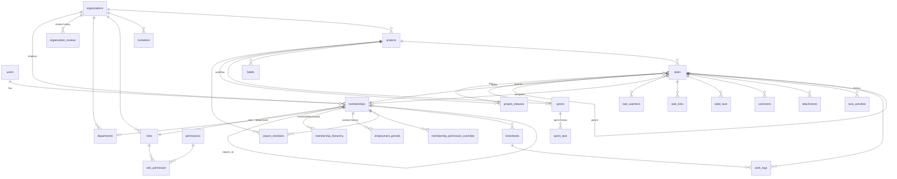

# Database Design

MySQL 8.4 · InnoDB · utf8mb4. Companion to [PLAN.md](PLAN.md) and [WORKFLOW.md](WORKFLOW.md).

## Design principles
1. **`users` = a person's login account (global). `memberships` = that person inside one company.**
   All business records (tasks, comments, work logs, projects) point to **`memberships.id`**, not `users.id`.
   This means a person's role, manager, department, and exit status are always per company. On **rehire** the same membership row is restored, so the person's old history reconnects automatically.
2. **Every company-owned table has `organization_id`**, indexed, so every query is scoped to one company (tenant isolation).
3. **Soft deletes** (`deleted_at`) on companies, memberships, departments, projects, tasks, comments, attachments, and work logs. **Users are never deleted**, only anonymized.
4. **The hierarchy is stored twice:** `memberships.reports_to_id` (the direct manager) plus `membership_hierarchy` (a closure table: every ancestor/descendant pair), so "all people under me" is one indexed join.
5. **Custom role/permission tables** (instead of spatie/laravel-permission), because roles attach to *memberships* (not users), need `level` and `data_scope`, and need per-user **grant or revoke** overrides.
6. Times are stored in **minutes** (integers). Money is not used.

---

## ER Diagram (core)



---

## 1. Platform & Company

### `users` (global login account)
| Column | Type | Notes |
|---|---|---|
| id | bigint PK | |
| name | varchar(150) | |
| email | varchar(191) **unique** | |
| phone | varchar(30) null | |
| password | varchar(255) | |
| avatar_path | varchar(255) null | |
| is_system_admin | bool default 0 | platform Super Admin |
| status | enum(`active`,`locked`,`anonymized`) | never hard-deleted |
| email_verified_at | timestamp null | |
| last_login_at | timestamp null | |
| last_organization_id | bigint null | company opened last time (company switcher) |
| remember_token, timestamps | | |

### `organizations` (companies)
| Column | Type | Notes |
|---|---|---|
| id | bigint PK | |
| name | varchar(191) | |
| slug | varchar(100) **unique** | URL-safe short code |
| industry, size | varchar null | |
| address | text null | |
| phone, email, website | varchar null | |
| registration_no | varchar(100) null | trade license |
| logo_path | varchar null | |
| timezone | varchar(50) default `Asia/Dhaka` | |
| date_format | varchar(20) | |
| working_days | json | e.g. `[0,1,2,3,4]` (Sun–Thu) |
| status | enum(`pending`,`info_requested`,`active`,`rejected`,`suspended`) | index |
| user_limit | int null | null = unlimited |
| applicant_user_id | FK users | contact person |
| approved_by | FK users null | system admin |
| approved_at, suspended_at | timestamp null | |
| settings | json null | |
| timestamps, deleted_at | | |

### `organization_reviews` (approval history)
| Column | Type | Notes |
|---|---|---|
| id | bigint PK | |
| organization_id | FK | |
| action | enum(`submitted`,`resubmitted`,`approved`,`rejected`,`info_requested`,`suspended`,`reactivated`) | |
| note | text null | reason / message to applicant |
| acted_by | FK users | |
| created_at | timestamp | |

### `organization_documents`
`id, organization_id, type (trade_license/other), path, original_name, mime, size, uploaded_by → users, timestamps`

---

## 2. Roles & Permissions

### `permissions` (global catalog, seeded)
| Column | Type | Notes |
|---|---|---|
| id | bigint PK | |
| name | varchar(100) **unique** | e.g. `task.assign` |
| module | varchar(50) | groups rows in the matrix UI |
| label | varchar(150) | "Assign tasks" |
| sort_order | smallint | |

### `roles`
| Column | Type | Notes |
|---|---|---|
| id | bigint PK | |
| organization_id | FK null | **null = system default template** (copied on approval) |
| name | varchar(100) | HOD, DGM, AGM, DM, PM, Team Lead, Developer, … |
| slug | varchar(100) | unique(organization_id, slug) |
| level | tinyint | 0 = Company Admin, 10 HOD, 20 DGM, 30 AGM, 40 DM, 50 PM, 60 TL, 70 Dev, 80 Stakeholder |
| data_scope | enum(`own`,`team`,`department`,`organization`) | |
| is_external | bool | for External Stakeholder role |
| is_locked | bool | Company Admin role cannot be edited or deleted |
| description | varchar null | |
| timestamps, deleted_at | | |

### `role_permission`
`role_id FK, permission_id FK` — PK(role_id, permission_id)

### `membership_permission_overrides` (per-user exceptions)
| Column | Type | Notes |
|---|---|---|
| membership_id | FK | PK part |
| permission_id | FK | PK part |
| effect | enum(`grant`,`revoke`) | |
| granted_by | FK memberships | |
| timestamps | | |

**Effective permissions** = (role permissions ∪ grants) − revokes. Cached per membership and cleared on any change.

---

## 3. People, Hierarchy, Exit & Rehire

### `departments`
| Column | Type | Notes |
|---|---|---|
| id | bigint PK | |
| organization_id | FK | |
| parent_id | FK departments null | sub-departments (optional) |
| name | varchar(150) | unique(organization_id, name) |
| code | varchar(20) null | |
| head_membership_id | FK memberships null | HOD |
| timestamps, deleted_at | | |

### `memberships` (person inside a company, **one row per company + user**)
| Column | Type | Notes |
|---|---|---|
| id | bigint PK | ← referenced by tasks, comments, etc. |
| organization_id | FK | |
| user_id | FK users | **unique(organization_id, user_id)** |
| role_id | FK roles | |
| department_id | FK null | |
| reports_to_id | FK memberships null | direct manager |
| user_type | enum(`internal`,`external`) | external = never in hierarchy |
| employee_code | varchar(50) null | unique(organization_id, employee_code) |
| designation | varchar(100) null | job title text |
| status | enum(`invited`,`active`,`exited`) | index(organization_id, status) |
| joined_at | date null | current period start |
| scheduled_exit_at | date null | scheduler exits them on this date |
| left_at | date null | |
| exit_type | enum(`resigned`,`terminated`,`contract_ended`) null | |
| exit_reason | text null | |
| exited_by | FK memberships null | |
| timestamps | | |
| deleted_at | timestamp null | **soft delete on exit, restored on rehire** |

Indexes: `(organization_id, status)`, `(organization_id, reports_to_id)`, `(organization_id, department_id)`.

### `membership_hierarchy` (closure table)
| Column | Type | Notes |
|---|---|---|
| ancestor_id | FK memberships | |
| descendant_id | FK memberships | |
| depth | tinyint | 0 = self, 1 = direct report, 2 = report's report, … |

PK(ancestor_id, descendant_id) · index(descendant_id).
Rebuilt for the affected subtree whenever `reports_to_id` changes, someone exits, or someone is rehired.

### `employment_periods` (join / exit history)
| Column | Type | Notes |
|---|---|---|
| id | bigint PK | |
| membership_id | FK | |
| joined_at | date | |
| left_at | date null | null = current period |
| role_id, department_id, reports_to_id | FK | snapshot at join (updated if changed during period) |
| designation | varchar null | |
| exit_type | enum null | |
| exit_reason | text null | |
| created_by | FK memberships null | |
| timestamps | | |

### `invitations`
| Column | Type | Notes |
|---|---|---|
| id | bigint PK | |
| organization_id | FK | |
| email | varchar(191) | index |
| role_id, department_id, reports_to_id | FK | |
| user_type | enum(`internal`,`external`) | |
| designation, employee_code | varchar null | |
| rehire_membership_id | FK memberships null | set when it is a rehire |
| token_hash | char(64) unique | sha256 of the emailed token |
| invited_by | FK memberships | |
| expires_at | timestamp | 7 days |
| accepted_at, revoked_at | timestamp null | |
| timestamps | | |

### `teams` / `team_members` (optional label grouping, e.g. "Payments Team")
`teams: id, organization_id, department_id, name, lead_membership_id, timestamps, deleted_at`
`team_members: team_id, membership_id` (PK both)

---

## 4. Projects

### `projects`
| Column | Type | Notes |
|---|---|---|
| id | bigint PK | |
| organization_id | FK | |
| department_id | FK null | |
| key | varchar(10) | `ECP` · unique(organization_id, key) |
| name | varchar(191) | |
| description | text null | |
| manager_membership_id | FK memberships null | PM |
| status | enum(`active`,`on_hold`,`completed`,`archived`) | |
| start_date, end_date | date null | |
| uses_sprints | bool default 1 | off = Kanban mode |
| progress_mode | enum(`count`,`points`) | |
| triage_mode | enum(`off`,`external_only`,`all_stakeholders`) | |
| client_can_see_all | bool default 0 | external stakeholders see every task |
| allow_self_close | bool default 0 | developer may move own task to Done |
| task_counter | int unsigned default 0 | next task number (row-locked on increment) |
| created_by | FK memberships | |
| timestamps, deleted_at | | |

### `project_members`
| Column | Type | Notes |
|---|---|---|
| id | bigint PK | |
| project_id | FK | |
| membership_id | FK | unique(project_id, membership_id) |
| project_role | enum(`manager`,`member`,`stakeholder`,`viewer`) | |
| added_by | FK memberships | |
| joined_at | timestamp | |
| left_at | timestamp null | set on removal or exit; cleared on re-add |

### `project_statuses` (board columns / workflow)
| Column | Type | Notes |
|---|---|---|
| id | bigint PK | |
| project_id | FK | |
| name | varchar(50) | Triage, Backlog, To Do, In Progress, In Review, Blocked, Done, Cancelled, Rejected |
| category | enum(`triage`,`todo`,`in_progress`,`done`,`cancelled`) | drives progress % |
| color | varchar(7) | |
| position | smallint | column order |
| is_initial | bool | default status for new tasks |
| show_on_board | bool | |

### `status_transitions` (optional, which moves are allowed)
`id, project_id, from_status_id, to_status_id, required_permission varchar null` (e.g. `task.close`)

### `labels`
`id, project_id, name, color` · unique(project_id, name)

---

## 5. Sprints

### `sprints`
| Column | Type | Notes |
|---|---|---|
| id | bigint PK | |
| project_id | FK | |
| name | varchar(100) | |
| goal | text null | |
| start_date, end_date | date | |
| status | enum(`planned`,`active`,`completed`) | max 1 active per project (app rule) |
| started_at, completed_at | timestamp null | |
| committed_points, completed_points | decimal(6,1) null | snapshot at start/complete |
| created_by | FK memberships | |
| timestamps, deleted_at | | |

### `sprint_task` (sprint history, used by reports)
| Column | Type | Notes |
|---|---|---|
| sprint_id | FK | PK part |
| task_id | FK | PK part |
| added_at | timestamp | |
| removed_at | timestamp null | |
| points_at_start | decimal(5,1) null | |
| outcome | enum(`completed`,`carried_over`,`removed`) null | set on sprint complete |

---

## 6. Tasks

### `tasks`
| Column | Type | Notes |
|---|---|---|
| id | bigint PK | |
| organization_id | FK | denormalized for scoping |
| project_id | FK | |
| number | int unsigned | unique(project_id, number) → key `ECP-42` |
| parent_id | FK tasks null | epic → story → subtask |
| type | enum(`epic`,`story`,`task`,`bug`,`subtask`) | |
| title | varchar(255) | fulltext index (title) |
| description | longtext null | rich text (HTML) |
| status_id | FK project_statuses | |
| priority | tinyint | 1 lowest … 5 highest |
| reporter_id | FK memberships | |
| assignee_id | FK memberships null | |
| sprint_id | FK sprints null | |
| story_points | decimal(5,1) null | |
| original_estimate_min | int unsigned null | |
| remaining_estimate_min | int unsigned null | |
| time_spent_min | int unsigned default 0 | cached sum of work_logs |
| start_date, due_date | date null | |
| board_position | decimal(20,10) | order inside a column (cheap reorder) |
| backlog_rank | decimal(20,10) | order in backlog |
| resolution_note | text null | rejection / cancel reason |
| completed_at | timestamp null | set when status category = done |
| created_by, updated_by | FK memberships | |
| timestamps, deleted_at | | |

Indexes: `(project_id, status_id, board_position)`, `(organization_id, assignee_id, status_id)`, `(organization_id, reporter_id)`, `(sprint_id)`, `(parent_id)`, `(organization_id, due_date)`, `(organization_id, completed_at)`.

### `task_watchers`
`task_id, membership_id` — PK both

### `task_links`
`id, source_task_id, target_task_id, type enum(blocks, relates_to, duplicates, clones), created_by` · unique(source, target, type)
(The reverse "is blocked by" is derived when reading.)

### `label_task`
`label_id, task_id` — PK both

### `comments`
| Column | Type | Notes |
|---|---|---|
| id | bigint PK | |
| task_id | FK | |
| membership_id | FK | author |
| body | text | |
| is_internal | bool | hidden from external stakeholders |
| edited_at | timestamp null | |
| timestamps, deleted_at | | |

### `comment_mentions`
`comment_id, membership_id` — PK both

### `attachments` (polymorphic: task, comment, project)
`id, organization_id, attachable_type, attachable_id, membership_id, disk, path, original_name, mime, size_bytes, timestamps, deleted_at` · index(attachable_type, attachable_id)

### `task_activities` (per-task history timeline)
| Column | Type | Notes |
|---|---|---|
| id | bigint PK | |
| organization_id | FK | |
| task_id | FK | index(task_id, created_at) |
| membership_id | FK null | null = system |
| event | varchar(40) | created, updated, status_changed, assigned, sprint_changed, commented, attachment_added, linked, triage_accepted, … |
| field | varchar(50) null | |
| old_value, new_value | text null | |
| meta | json null | |
| created_at | timestamp | |

---

## 7. Time Tracking

### `timesheets`
| Column | Type | Notes |
|---|---|---|
| id | bigint PK | |
| organization_id | FK | |
| membership_id | FK | unique(membership_id, week_start) |
| week_start | date | |
| total_min | int unsigned | |
| status | enum(`draft`,`submitted`,`approved`,`returned`) | |
| submitted_at | timestamp null | |
| reviewed_by | FK memberships null | |
| reviewed_at | timestamp null | |
| review_note | text null | |
| timestamps | | |

### `work_logs`
| Column | Type | Notes |
|---|---|---|
| id | bigint PK | |
| organization_id | FK | |
| task_id | FK | |
| membership_id | FK | |
| timesheet_id | FK null | auto-attached to the week's timesheet |
| work_date | date | |
| minutes | int unsigned | |
| note | varchar(500) null | |
| timestamps, deleted_at | | locked when timesheet approved |

Indexes: `(membership_id, work_date)`, `(task_id)`.

---

## 8. Notifications, Filters, Audit

### `notifications` (Laravel standard)
`id uuid, type, notifiable_type, notifiable_id, data json (includes organization_id, task_id), read_at, timestamps`

### `notification_preferences`
`id, membership_id, event varchar(50), via_mail bool, via_app bool` · unique(membership_id, event)

### `saved_filters`
`id, membership_id, project_id null, name, filters json, is_shared bool, timestamps`

### `audit_logs` (admin and security actions)
| Column | Type | Notes |
|---|---|---|
| id | bigint PK | |
| organization_id | FK null | null = platform-level (company approval etc.) |
| actor_user_id | FK users | |
| action | varchar(60) | `role.permissions_updated`, `member.offboarded`, `member.rehired`, `company.approved`, … |
| auditable_type, auditable_id | morph | |
| old_values, new_values | json null | |
| ip_address | varchar(45) | |
| user_agent | varchar(255) | |
| created_at | timestamp | index(organization_id, created_at) |

### Laravel framework tables
`password_reset_tokens`, `sessions`, `cache`, `cache_locks`, `jobs`, `job_batches`, `failed_jobs`

---

## 9. Key Queries

**All people under me (any depth):**
```sql
SELECT m.* FROM membership_hierarchy h
JOIN memberships m ON m.id = h.descendant_id
WHERE h.ancestor_id = :me AND h.depth > 0 AND m.status = 'active';
```

**Tasks visible to me** (data scope = `team`), as used by the `VisibleTo` scope:
```sql
SELECT t.* FROM tasks t
WHERE t.organization_id = :org AND t.deleted_at IS NULL AND (
     t.reporter_id = :me OR t.assignee_id = :me
  OR EXISTS (SELECT 1 FROM task_watchers w WHERE w.task_id = t.id AND w.membership_id = :me)
  OR EXISTS (SELECT 1 FROM project_members pm
             WHERE pm.project_id = t.project_id AND pm.membership_id = :me AND pm.left_at IS NULL)
  OR EXISTS (SELECT 1 FROM membership_hierarchy h
             WHERE h.ancestor_id = :me AND h.descendant_id IN (t.assignee_id, t.reporter_id))
);
```
(`department` scope swaps the last check for an assignee department match; `organization` drops the checks entirely.)

**Next task number (safe under concurrency):**
```sql
SELECT task_counter FROM projects WHERE id = :p FOR UPDATE;  -- inside transaction
UPDATE projects SET task_counter = task_counter + 1 WHERE id = :p;
```

**Project progress:**
```sql
SELECT SUM(s.category = 'done') / NULLIF(SUM(s.category NOT IN ('cancelled','triage')), 0) * 100
FROM tasks t JOIN project_statuses s ON s.id = t.status_id
WHERE t.project_id = :p AND t.deleted_at IS NULL;
```

---

## 10. Exit & Rehire: what happens in the data

| Step | Data change |
|---|---|
| Offboard (scheduled) | `memberships.scheduled_exit_at` set |
| Exit | `memberships.status='exited'`, `left_at`, `exit_type`, `exit_reason`, `deleted_at=now()`; current `employment_periods.left_at` set; direct reports' `reports_to_id` changed; closure rows rebuilt; `project_members.left_at` set; `task_watchers` rows removed; open tasks reassigned; `audit_logs` row |
| Rehire | same `memberships` row: `deleted_at=null`, `status='active'`, new role/dept/manager, overrides deleted; new `employment_periods` row; closure rows rebuilt; chosen projects get `project_members.left_at=null`; `audit_logs` row |
| Email reused by different person | old `users.email` renamed to `archived+{id}@…`, `status='anonymized'` → new user + new membership |

---

## 11. Table Count Summary

| Group | Tables |
|---|---|
| Platform & company | users, organizations, organization_reviews, organization_documents |
| Roles & permissions | permissions, roles, role_permission, membership_permission_overrides |
| People | departments, memberships, membership_hierarchy, employment_periods, invitations, teams, team_members |
| Projects | projects, project_members, project_statuses, status_transitions, labels |
| Sprints | sprints, sprint_task |
| Tasks | tasks, task_watchers, task_links, label_task, comments, comment_mentions, attachments, task_activities |
| Time | timesheets, work_logs |
| Misc | notifications, notification_preferences, saved_filters, audit_logs |
| Framework | password_reset_tokens, sessions, cache, cache_locks, jobs, job_batches, failed_jobs |

**About 37 application tables, plus 7 Laravel framework tables.**
