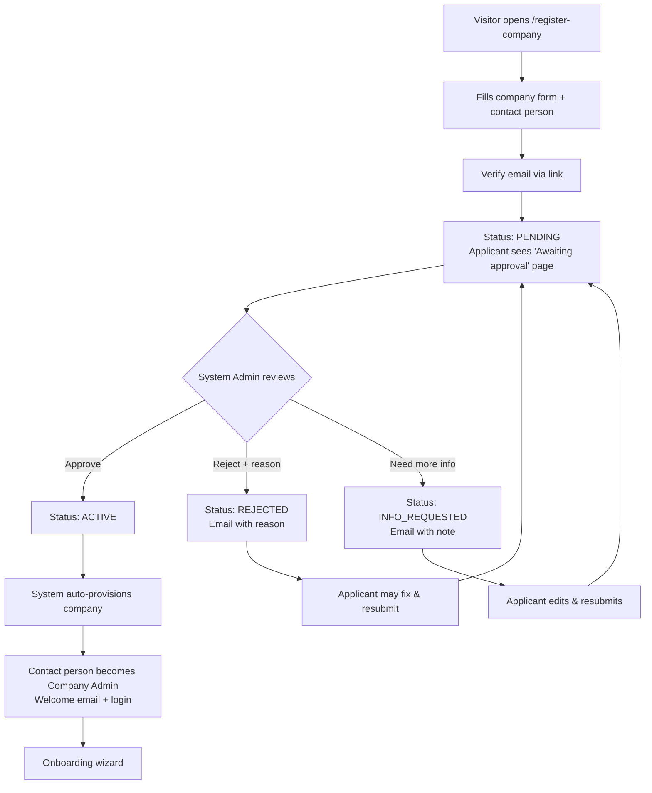
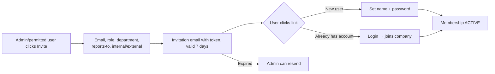
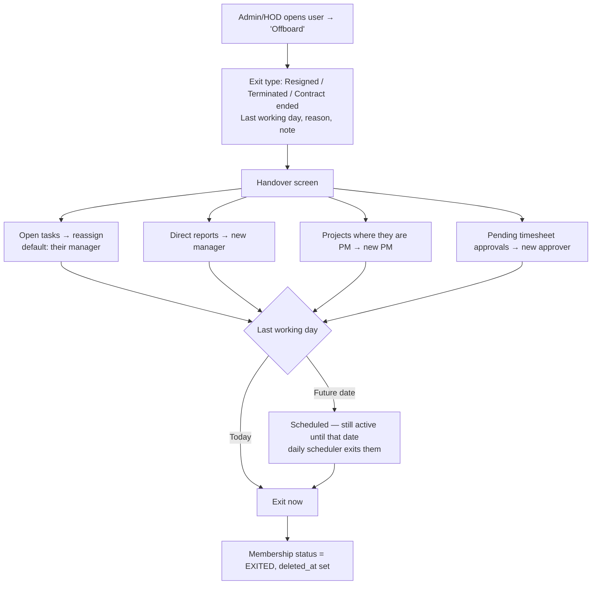
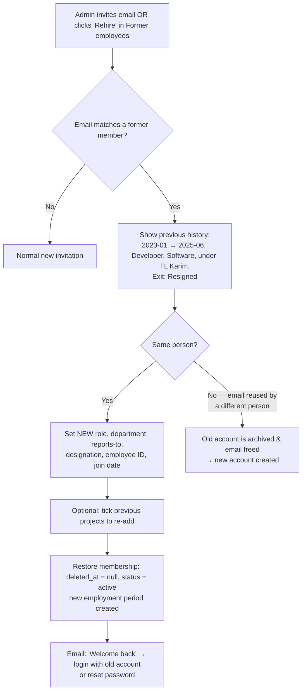
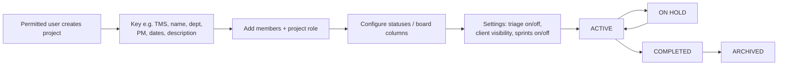
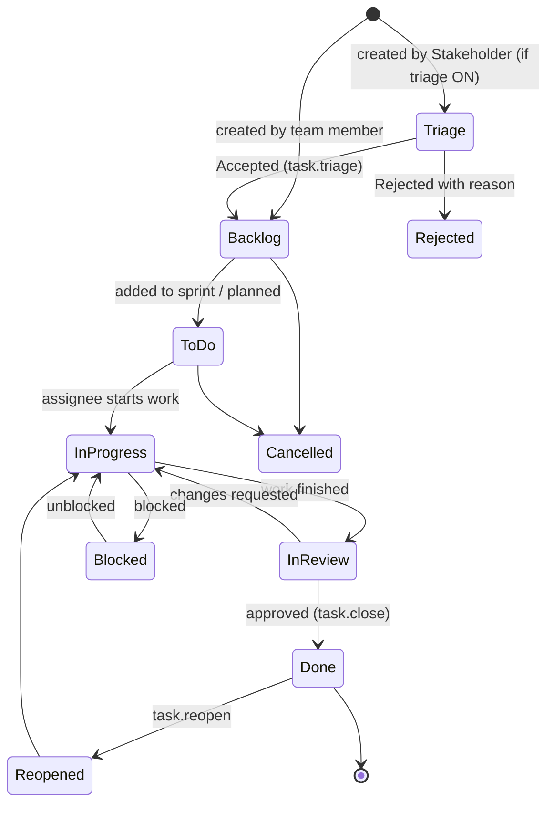
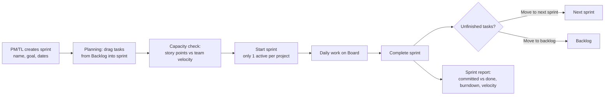

# Task Management System: Full Workflow

Companion to [PLAN.md](PLAN.md). This document describes **how the system behaves** end to end, from company registration to task completion and reporting.

**Confirmed decisions**
- Frontend: **Vue 3 + Inertia.js** (Laravel 12 backend)
- Hierarchy: **HOD → DGM → AGM → DM → TL → Developer**
- Companies **self-register**, and a **System Admin approves** them
- Stakeholders can be **internal or external** staff
- **Sprints and time tracking** are included in the first release
- **Every role has a permission for each feature**, configurable through a permission matrix

---

## 0. Actors

| Level | Actor | Belongs to | Purpose |
|---|---|---|---|
| Platform | **System Admin** (Super Admin) | The platform itself | Approves companies, manages the platform |
| Company | **Company Admin** | One company | Sets up the company, users, roles, and permissions |
| Company | HOD, DGM, AGM, DM, Team Lead, Developer | One company (internal) | The reporting hierarchy |
| Company | Project Manager | One company (internal) | Runs projects across teams |
| Company | Internal Stakeholder | One company (internal) | Raises and tracks requests in their projects |
| Company | External Stakeholder | Client or vendor (external) | Raises and tracks requests in their projects only |

---

## 1. Company Registration & Approval



### 1.1 Registration form
- **Company:** name, short code (used for URLs), industry, size, address, phone, website, trade license / registration number, optional document upload.
- **Contact person (future Company Admin):** name, designation, email, phone, password.
- Accept the platform terms.
- Email verification is required before the application reaches the review queue.

### 1.2 System Admin review
- **Pending Companies** list showing the submitted date, details, and documents.
- Actions:
  - **Approve:** the company becomes active and is provisioned (see 1.3).
  - **Reject:** a reason is required. The applicant is emailed and can edit and resubmit.
  - **Request info:** a note is emailed. The application waits for resubmission.
- The System Admin can also later **suspend** or **reactivate** a company, set a **user limit**, and view usage.

### 1.3 Auto-provisioning on approval
1. Create the organization record (status `active`).
2. Create the contact person's user and membership with the **Company Admin** role.
3. Copy the **default role template** (HOD, DGM, AGM, DM, PM, TL, Developer, Internal Stakeholder, External Stakeholder) with their default permissions and data scopes.
4. Copy the **default task workflow** (statuses) and default task types and priorities.
5. Send the welcome email.

### 1.4 Company states
`pending → active → suspended → active`, plus `pending → info_requested → pending` and `pending → rejected → pending` (on resubmission).
- While a company is **suspended**, nobody in it can log in, and its data is kept.

---

## 2. Company Onboarding (Company Admin)

The wizard runs after the first login. Every step can be skipped and finished later from Settings.

1. **Company profile:** logo, time zone, working days, date format.
2. **Departments:** e.g. Software, QA, Infrastructure. Assign the HOD later.
3. **Roles & permissions:** review the default matrix (section 4) and adjust it.
4. **Invite people:** one at a time, or by **CSV/Excel import** (name, email, role, department, reports-to email, internal or external).
5. **Build the hierarchy:** set "reports to" for each person (section 3). The org chart preview updates live.
6. **First project:** create a project and add members.

---

## 3. People & Hierarchy

### 3.1 Inviting a user


**Membership states:** `invited → active → exited (soft deleted) → active (rehired)`. See 3.4 and 3.5.

### 3.2 Hierarchy rules
```
HOD (level 10)
 └── DGM (20)
      └── AGM (30)
           └── DM (40)
                ├── Team Lead (60) ── Developers (70)
                └── Team Lead (60) ── Developers (70)
Project Manager (50): sits under a DM/AGM in the org chart; works across teams through project membership
```
- Every internal user except the top HOD has **exactly one "reports to"** manager.
- The manager must have a **higher rank** (lower level number). **Skipping levels is allowed** (e.g. a TL reporting directly to a DM when there is no AGM).
- **Cycles are blocked** (A → B → A).
- A DM can have 2 or more Team Leads. A Team Lead can have many Developers.
- **External users are never in the hierarchy.** They exist only as project members.
- Changing someone's manager rebuilds the hierarchy table, and visibility moves with them immediately. Tasks are not changed.

### 3.3 Org chart
- A tree view with avatar, name, role, and open task count. Click a person to see their tasks and workload (within your permission scope).

### 3.4 Employee Exit (Resign / Terminate): soft delete

**Key idea:** the **user account is never deleted**. Only their **membership in the company** ends.
That person's tasks, comments, work logs, and history stay linked to them, so reports stay correct.



**What happens on exit**
| Item | Action |
|---|---|
| Membership | `status = exited`, `left_at`, `exit_type`, `exit_reason` saved; **soft deleted** |
| Login | Sessions and tokens revoked. On login they see "Your access to ABC Soft ended on 30 Sep 2026". If they belong to another company, they can still use that one. |
| Hierarchy | Removed from the hierarchy table; their direct reports move to the new manager chosen at handover |
| Projects | Project memberships ended; the history of which projects they were on is kept |
| Tasks / comments / work logs | **Kept unchanged.** Their name shows as *"Rahim Uddin (Former)"* in grey |
| Watchers / notifications | Removed from watchers; they get no more emails |
| Dropdowns | Not shown in assignee or user pickers |
| Reports | Excluded by default; an **"Include former employees"** filter shows their past work |
| User limit | No longer counted against the company's user limit |

**Safety rules**
- The last remaining Company Admin cannot be offboarded.
- A person cannot be offboarded while they still have direct reports. The handover must be completed first.
- **Users → Former employees** tab lists everyone who has left: exit date, type, and last role.
- **Hard delete is not allowed** for companies. If a person requests data removal (privacy), only the System Admin can **anonymize** them ("Former User #123"). The records stay, but personal details are erased.

### 3.5 Rejoin (Rehire)

When the same person comes back, **reuse their existing account and membership**. Do not create a new account.
Their old work history is then connected to the new period.



**Rules on rehire**
- **Old permissions are not restored.** The user gets the permissions of the **new role** only, and old per-user overrides are cleared.
- Project memberships are **not restored automatically**. The admin chooses which old projects to re-add.
- Old tasks, comments, and work logs automatically show under the same person again (the same `user_id`).
- Their profile shows the **employment history**:
  ```
  Period 2: 2026-10-01 → present   Team Lead, Software, reports to DM Hasan
  Period 1: 2023-01-10 → 2025-06-30 Developer, Software, reports to TL Karim  (Resigned)
  ```
- Rehiring is blocked if the company has reached its user limit.

**Same person or a different person with the same email?**
Company emails such as `dev1@company.com` are sometimes reused. On rehire, the admin confirms that this is the **same person**. If it is a different person, the old account's email is renamed (archived) and a fresh account is created, so two people's histories never get mixed.

**Permissions for this:** `user.offboard`, `user.rehire`, `user.view_former` (Company Admin and HOD by default).

---

## 4. Roles, Permissions & Data Scope

Access is decided by **three checks together**:

```
Can user do ACTION on RECORD?
  1. PERMISSION : does the role (or user override) have this feature permission?   e.g. task.edit
  2. DATA SCOPE : is the record inside the role's data scope?                       e.g. Team
  3. PROJECT    : or is the user a member of the record's project with enough project role?
```

### 4.1 Data scope (per role, set by Company Admin)

| Scope | Sees records of… |
|---|---|
| **Own** | only tasks they reported, are assigned to, or watch |
| **Team** | themselves + everyone below them in the hierarchy (recursive) |
| **Department** | everyone in their department |
| **Organization** | the whole company |

Project membership **always adds** that project's tasks on top of the scope.

Default scopes: Company Admin = Organization; HOD = Department; DGM, AGM, DM, TL = Team; PM = Team (+ their projects); Developer and Stakeholders = Own (+ their projects).

### 4.2 Permission catalog (feature × action)

| Module | Permissions |
|---|---|
| Dashboard | `dashboard.view`, `dashboard.team`, `dashboard.department`, `dashboard.organization` |
| Company settings | `company.view_settings`, `company.edit_settings` |
| Departments | `department.view`, `department.create`, `department.edit`, `department.delete` |
| Users | `user.view`, `user.invite`, `user.import`, `user.edit`, `user.offboard`, `user.rehire`, `user.view_former`, `user.change_role`, `user.change_manager` |
| Roles & permissions | `role.view`, `role.create`, `role.edit`, `role.delete`, `permission.assign` |
| Org chart | `orgchart.view` |
| Projects | `project.view`, `project.create`, `project.edit`, `project.archive`, `project.delete`, `project.manage_members`, `project.manage_workflow`, `project.manage_settings` |
| Tasks | `task.view`, `task.create`, `task.edit_own`, `task.edit_any`, `task.delete_own`, `task.delete_any`, `task.assign`, `task.change_status`, `task.close` (move to Done), `task.reopen`, `task.triage` (accept/reject requests), `task.move_project`, `task.bulk_update`, `task.link` |
| Comments | `comment.create`, `comment.edit_own`, `comment.delete_own`, `comment.delete_any` |
| Attachments | `attachment.upload`, `attachment.delete_own`, `attachment.delete_any` |
| Labels | `label.manage` |
| Backlog & sprints | `backlog.view`, `backlog.reorder`, `sprint.view`, `sprint.create`, `sprint.edit`, `sprint.start`, `sprint.complete`, `sprint.delete` |
| Time tracking | `worklog.create`, `worklog.edit_own`, `worklog.view_team`, `worklog.edit_any`, `timesheet.approve` |
| Reports | `report.view`, `report.team`, `report.department`, `report.organization`, `report.export` |
| Audit | `audit.view` |

`_own` means a record the user created. `_any` means any record within their scope.

### 4.3 Default permission matrix (editable)

✔ = granted by default; blank = not granted.

| Permission group | Co. Admin | HOD | DGM | AGM | DM | PM | TL | Dev | Int. Stakeholder | Ext. Stakeholder |
|---|---|---|---|---|---|---|---|---|---|---|
| Company settings, roles | ✔ | | | | | | | | | |
| Departments manage | ✔ | ✔ | | | | | | | | |
| Invite / edit users | ✔ | ✔ | ✔ | ✔ | ✔ | | | | | |
| Change manager / role | ✔ | ✔ | ✔ | | | | | | | |
| Org chart view | ✔ | ✔ | ✔ | ✔ | ✔ | ✔ | ✔ | ✔ | ✔ | |
| Project create / edit | ✔ | ✔ | ✔ | ✔ | ✔ | ✔ | | | | |
| Project members & workflow | ✔ | ✔ | ✔ | ✔ | ✔ | ✔ | ✔ | | | |
| Task create | ✔ | ✔ | ✔ | ✔ | ✔ | ✔ | ✔ | ✔ | ✔ | ✔ |
| Task edit own | ✔ | ✔ | ✔ | ✔ | ✔ | ✔ | ✔ | ✔ | ✔ | ✔ |
| Task edit any (in scope) | ✔ | ✔ | ✔ | ✔ | ✔ | ✔ | ✔ | | | |
| Task assign | ✔ | ✔ | ✔ | ✔ | ✔ | ✔ | ✔ | | | |
| Task change status | ✔ | ✔ | ✔ | ✔ | ✔ | ✔ | ✔ | ✔ | | |
| Task close / reopen | ✔ | ✔ | ✔ | ✔ | ✔ | ✔ | ✔ | | ✔ (reopen) | ✔ (reopen) |
| Task triage | ✔ | ✔ | | | ✔ | ✔ | ✔ | | | |
| Task delete any | ✔ | ✔ | | | | ✔ | | | | |
| Comment / attach | ✔ | ✔ | ✔ | ✔ | ✔ | ✔ | ✔ | ✔ | ✔ | ✔ |
| Sprint manage | ✔ | | | | ✔ | ✔ | ✔ | | | |
| Backlog reorder | ✔ | | | | ✔ | ✔ | ✔ | | | |
| Log work | ✔ | ✔ | ✔ | ✔ | ✔ | ✔ | ✔ | ✔ | | |
| View team worklogs | ✔ | ✔ | ✔ | ✔ | ✔ | ✔ | ✔ | | | |
| Approve timesheet | ✔ | | | | ✔ | | ✔ | | | |
| Reports: team | ✔ | ✔ | ✔ | ✔ | ✔ | ✔ | ✔ | | | |
| Reports: department / org | ✔ | ✔ | ✔ | | | | | | | |
| Report export | ✔ | ✔ | ✔ | ✔ | ✔ | ✔ | ✔ | | | |
| Audit log | ✔ | ✔ | | | | | | | | |

### 4.4 Managing permissions (Company Admin workflow)
1. **Settings → Roles & Permissions** shows a grid: rows are permissions grouped by module, columns are roles, and each cell is a checkbox.
2. Set each role's **data scope** from a dropdown.
3. **Create custom roles** (e.g. "QA Lead") with a level number, then copy permissions from an existing role.
4. **Per-user overrides (optional):** grant or revoke an individual permission for one user without changing their role.
5. Every change is recorded in the **audit log** and takes effect immediately (the permission cache is cleared).
6. The System Admin maintains the **default template**, which is copied to newly approved companies.

### 4.5 External stakeholder restrictions (hard rules, not configurable)
- They see **only the projects they are added to**, never the company directory, org chart, or other projects.
- They see **only the tasks they created or are watching** in those projects, unless the PM sets the project to "client can see all tasks".
- They cannot see **internal comments**. Comments have an **Internal / Public** toggle, and internal is the default for internal users.
- They cannot see time logs or estimates.

---

## 5. Project Workflow



**Project roles** (inside a project, in addition to the org role):

| Project role | Can do in this project |
|---|---|
| Project Manager | Everything: members, workflow, sprints, all tasks |
| Member | Work on tasks according to their org permissions |
| Stakeholder | Create requests, comment, track progress |
| Viewer | Read only |

---

## 6. Task Lifecycle

### 6.1 Default statuses (each project can customize)


Every status belongs to a **category** (`todo`, `in_progress`, `done`), and progress % is calculated from these categories.

### 6.2 Creating a task
1. Click **+ Create** (global) or **+** in a board column or backlog.
2. Pick a project (only projects where the user has `task.create` and membership).
3. Choose a type: **Epic / Story / Task / Bug / Sub-task**.
4. Fill in the fields: title*, description, priority, assignee, labels, parent epic, sprint, story points, original estimate, start and due dates, attachments.
5. On save:
   - The task gets the next key (`TMS-43`).
   - Its initial status is **Triage** if the creator is a stakeholder and the project has triage ON. Otherwise it is **Backlog**, or **To Do** if a sprint was chosen.
   - The reporter and assignee are added as watchers automatically.
   - The activity log records "created". Notifications are sent (section 10).

### 6.3 Triage (stakeholder requests)
- Requests appear in the project's **Triage queue**, visible to anyone with `task.triage` (PM, TL, DM).
- **Accept:** set the type, priority, and assignee, and the task moves to Backlog.
- **Reject:** a reason is required. The stakeholder is notified, and the task is closed as `Rejected`.
- **Need info:** a comment is posted to the stakeholder, and the task stays in Triage.
- Triage is ON by default for external stakeholders and configurable for internal ones.

### 6.4 Assignment rules
- Anyone can **assign to themselves** if they are a project member and have `task.change_status`.
- With `task.assign`, a user can assign to **project members who are in their data scope**. A PM can assign to any member of their projects.
- Reassigning notifies both the old and new assignee and is logged.

### 6.5 Working a task
- Drag the card on the board, or change the status in the task view. The allowed moves follow the diagram above.
- **Log work:** hours or minutes, date, and a note. The remaining estimate decreases automatically.
- Comments (Internal/Public), @mentions, attachments, links (blocks / is blocked by / relates / duplicates), and sub-tasks.
- A parent task cannot be closed while its sub-tasks are open (warning, with an option to close them all).
- **Inline editing:** on the list and on board cards, click a title, status, assignee, priority, due date or points to change it in place (Enter or leaving the field saves, Esc cancels). The same rules apply as on the task page; a refusal shows next to the field. Controls only appear for people who may edit that task.
- **Drag across swimlanes:** on a board grouped by assignee, dropping a card into another person's lane assigns the task to them as well as moving it; grouped by epic, it moves the task under that epic. A task under a story, or a sub-task, keeps its parent. If any part of the drop is refused, nothing changes.
- **Quick add:** the "Add task" box at the foot of a column, the backlog or a sprint creates a task there from one line of text. `@name` assigns, `!3` (or `!high`) sets the priority, `#label` adds a label. Planning into a sprint needs the sprint right; requests from stakeholders still go through triage.

### 6.6 Closing & reopening
- **Done** requires `task.close`. By default the TL, PM, or a manager reviews the work in `In Review` and closes it. If the project allows self-close, the developer can close their own task.
- `completed_at` is stamped, progress rolls up, and the reporter and watchers are notified.
- **Reopen** requires `task.reopen` (stakeholders have it, so they can say "not fixed").

---

## 7. Sprint Workflow (Scrum)



- Projects can switch sprints **off** to work in **Kanban mode** (continuous board, no sprints).
- During planning, each person's total points and hours are shown so nobody is overloaded.

---

## 8. Time Tracking Workflow
1. A developer logs time on a task (or from the **My Timesheet** weekly grid).
2. At week's end, they **submit** the timesheet.
3. The TL or DM (`timesheet.approve`) **approves** it or **returns** it with a comment.
4. Approved hours feed the reports: effort per project, per person, estimate vs. actual.
5. Approved entries are locked. Editing them requires `worklog.edit_any`.

---

## 9. Progress Visibility & Dashboards

Each dashboard widget uses the viewer's **data scope** and **projects**.

| Viewer | Default dashboard |
|---|---|
| Developer | My open tasks, due today/this week, overdue, current sprint progress, my logged hours |
| Team Lead | Team workload per developer (To Do / In Progress / Done), overdue & blocked tasks, sprint burndown, pending timesheets |
| DM | Per-TL team rollup: completion %, overdue, velocity trend, projects under them |
| AGM / DGM | Per-DM rollup, project health (on track / at risk / delayed), department trends |
| HOD | Whole department: all projects' % complete, team comparison, overdue heatmap, effort hours |
| Project Manager | Project % complete, sprint burndown, velocity, status distribution, blocked items, triage queue count |
| Stakeholder | Their requests by status, progress of projects they follow |
| Company Admin | Company-wide stats, user count, active projects |
| System Admin | Companies pending/active/suspended, platform usage |

**Drill-down:** HOD → department → DGM/AGM/DM → Team Lead → developer → task. Every number can be clicked through to the filtered task list.

**Progress formula:** `done tasks ÷ total tasks` (or by story points, a per-project setting), excluding Cancelled and Rejected tasks.
**Project health:** *Delayed* if past the end date and not done; *At risk* if more than 20% of tasks are overdue or the burndown is behind; otherwise *On track*.

---

## 10. Notifications

| Event | Recipients | Channel |
|---|---|---|
| Company registered | System Admins | Email + in-app |
| Company approved / rejected / info requested | Applicant | Email |
| Invitation | Invitee | Email |
| Task assigned / reassigned | New + old assignee | In-app + email |
| Task created in triage | Users with `task.triage` in the project | In-app |
| Triage accepted / rejected | Stakeholder (reporter) | In-app + email |
| Status changed | Reporter, assignee, watchers | In-app |
| Task closed / reopened | Reporter, assignee, watchers | In-app + email |
| Comment / @mention | Watchers / mentioned user | In-app (+ email for mention) |
| Due tomorrow | Assignee | In-app + email (daily scheduler) |
| Overdue | Assignee + their direct manager | In-app + email (daily) |
| Sprint started / completed | Project members | In-app |
| Timesheet submitted / returned | Approver / submitter | In-app |

Users can switch email on or off per event type in **Profile → Notifications**.

---

## 11. Audit & Activity
- **Task activity:** every field change, with who, when, and the old → new value.
- **Audit log** (admin actions): role and permission changes, user invites and deactivations, manager changes, project deletes, and company approvals (platform level).
- Soft delete is used for tasks, projects, and users, with a restore option for permitted roles.

---

## 12. Screen Map

**Public:** Landing · Login · Register Company · Pending Approval · Accept Invitation · Forgot Password

**System Admin:** Dashboard · Companies (pending / all) · Company detail (approve/reject/suspend) · Default Role Template · Platform Settings · Audit Log

**Company app:**
- Dashboard (role-based)
- My Work (assigned / reported / watching)
- Projects list → Project: **Board · Backlog · Sprints · List · Triage · Reports · Settings (members, workflow, options)**
- Task detail (full-page view, and a side panel that opens over the board, list, backlog and sprint pages; a link with `?task=ECP-12` opens it directly)
- Keyboard: `Ctrl+K` or `/` search, `C` create, `J`/`K` move through tasks, `Enter` open, `A` `S` `P` `D` assign, status, priority, due date of the selected task, `G` then a letter to go to a page, `?` lists them all
- Team view / Org chart
- Timesheet (mine / team approval)
- Reports (team, department, org, export)
- Settings: Company profile · Departments · Users & Invitations · **Roles & Permissions matrix** · Labels · Audit log
- Profile & notification preferences
- Company switcher (if the user belongs to more than one company)

---

## 13. End-to-End Example

1. **ABC Soft Ltd** registers. The System Admin approves it. Rahim (contact person) becomes Company Admin.
2. Rahim creates the department **Software**, then invites the HOD → DGM → AGM → DM. The DM has 2 TLs, and each TL has 3 developers. He also invites one PM and one external client stakeholder.
3. The PM creates project **"E-Commerce Portal" (ECP)** with sprints ON and triage ON, and adds both TL teams and the client.
4. The client creates *"Payment page shows wrong total"*, which lands in **Triage**.
5. TL-A accepts it as a **Bug**, priority High, and assigns it to Dev-1. It moves to the Backlog.
6. The PM plans **Sprint 1** with ECP-1…ECP-15 and starts it.
7. Dev-1 moves ECP-7 to **In Progress**, logs 3h, and moves it to **In Review**.
8. TL-A reviews it and moves it to **Done**. The client is notified and sees it on their dashboard.
9. The DM sees both TL teams' progress. The AGM, DGM, and HOD see the rollup per DM and project. Dev-2 (in TL-B's team) **cannot see** TL-A's team's tasks unless they are on the same project.
10. The PM completes the sprint. Unfinished tasks go to Sprint 2. The burndown and velocity reports are generated.
